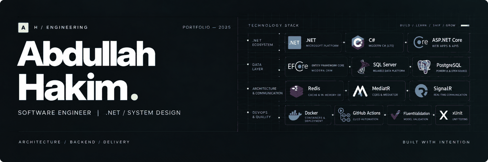

 

**Software Engineer · .NET Backend Developer · MSc Candidate @ Politecnico di Milano**

*Turning complex business requirements into dependable, maintainable software.*

---

### `> whoami`

I'm a software engineer with a backend-first mindset. I design **APIs, domain models, and application architectures** that are easy to reason about, test, and evolve. My work spans enterprise workflows, data-intensive systems, background processing, and full-stack product development.

- 🏗️ **Engineering focus:** Clean Architecture, Domain-Driven Design, CQRS, and pragmatic system design.
- ⚙️ **Daily toolkit:** C#, ASP.NET Core, EF Core, SQL Server, PostgreSQL, and Docker.
- 🧠 **Currently exploring:** architectural boundaries, reliable distributed workflows, and engineering leadership.
- 🎯 **My approach:** favor clarity over cleverness, sensible trade-offs over unnecessary complexity, and outcomes over buzzwords.

### `> selected_work`

<table>
<tr>
<td width="50%" valign="top">

#### [Hakim Platform · Architecture Showcase](https://github.com/AbdullahHakima/Hakim-Architecture)

A personal platform with an automated job-application workflow, background processing, AI integrations, and documented architecture decisions.

`Clean Architecture` · `CQRS` · `PostgreSQL` · `Next.js`

[Explore architecture →](https://github.com/AbdullahHakima/Hakim-Architecture)

</td>
<td width="50%" valign="top">

#### [SewTec CRM](https://github.com/AbdullahHakima/SewTec_CRM)

A full-stack customer relationship management application featuring branch-scoped access, customer workflows, and a Next.js interface.

`ASP.NET Core` · `Next.js` · `JWT` · `Docker`

[View repository →](https://github.com/AbdullahHakima/SewTec_CRM)

</td>
</tr>
<tr>
<td width="50%" valign="top">

#### [Store API](https://github.com/AbdullahHakima/Store-using-DotNETCore-API)

An e-commerce API exploring rich domain models, EF Core, auditing, concurrency control, and efficient query patterns.

`.NET` · `EF Core` · `SQL Server` · `DDD`

[Explore the API →](https://github.com/AbdullahHakima/Store-using-DotNETCore-API)

</td>
<td width="50%" valign="top">

#### [GeoGuard API](https://github.com/AbdullahHakima/SorTech-Task)

A country-based IP blocking service using thread-safe in-memory repositories, external geolocation, and focused domain modeling.

`ASP.NET Core` · `Concurrent Collections` · `xUnit`

[See engineering decisions →](https://github.com/AbdullahHakima/SorTech-Task)

</td>
</tr>
</table>

### `> toolkit --overview`

**Backend & data**

**Architecture & practices**

**Delivery & frontend**

### `> github --at-a-glance`

> **Engineering principle:** Build the simplest architecture that can meet today's needs without closing the door on tomorrow's growth.

---

**Let's build something useful.**

[Portfolio](https://abdullahhakim.me) · [LinkedIn](https://www.linkedin.com/in/abdullahhakimam/) · [Email](mailto:contact@abdullahhakim.me)

Designed with intent. Built around real engineering work.

